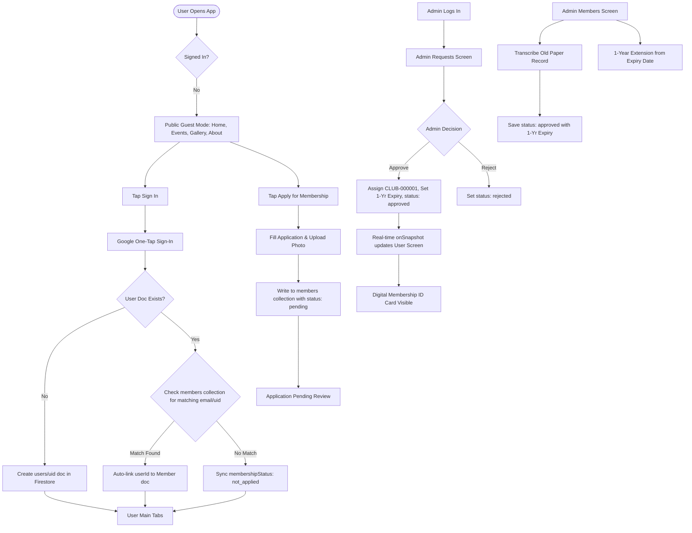

# Universal Club — Mobile App Blueprint & Website Reconstruction Reference

> **Comprehensive reference document** for rebuilding the design, user flows, architecture, database schemas, and business logic of the Universal Club mobile application into an existing responsive website.
> 
> *Source codebase:* `d:\universalApp`  
> *Verification source:* Static code audit of all JavaScript/JSX source files, navigation trees, design tokens, data models, and active runtime logs.

---

## 1. Project Overview

### 1.1 Technology Stack & Core Frameworks
* **Runtime & Framework:** React Native `0.81.5` / Expo `~54.0.37` (with Fabric New Architecture enabled).
* **Core React Engine:** React `19.1.0` / React DOM `19.1.0`.
* **Navigation:** React Navigation v7 (`@react-navigation/native` `^7.3.17`, `@react-navigation/bottom-tabs` `^7.18.17`, `@react-navigation/native-stack` `^7.18.9`).
* **Backend & Database:** Firebase JS SDK `^12.18.0` (Firebase Authentication, Cloud Firestore).
* **Media & Cloud Storage:** ImageKit Client SDK `imagekit-javascript` `^4.0.1` (with client-side HMAC-SHA1 signature generation and optional Express signing microservice in `server/`).
* **Key Native Modules:**
  * `@react-native-google-signin/google-signin` `^16.1.5` (Native Google Authentication)
  * `expo-video` `~3.0.16` (Hardware-accelerated looping video playback in hero slider)
  * `expo-image-picker` `~17.0.11` (Camera and media library photo selection)
  * `expo-secure-store` `~15.0.8` (Encrypted auth token and session storage)
  * `@react-native-async-storage/async-storage` `2.2.0` (Firebase Auth persistence & local storage fallback)
  * `expo-crypto` `~15.0.9` (SHA-1 HMAC generation for ImageKit & SHA-256 password hashing)
  * `@expo-google-fonts/plus-jakarta-sans` `^0.4.2` (Custom typography weights 400, 500, 600, 700, 800)
  * `@expo/vector-icons` `^15.0.3` (Ionicons icon library)

### 1.2 Folder Structure & File Map
```
universalApp/
├── App.jsx                       # Root component: Font loader, SafeAreaProvider, AuthProvider, AppNavigator
├── index.js                      # Entry point registering root component
├── app.json                      # Expo app configuration, bundle identifiers, Google Web Client ID
├── firestore.rules               # Firestore security rules
├── assets/                       # Static brand assets (club-logo.webp, icons, splash)
├── server/                       # Standalone Node.js/Express ImageKit signing server
│   └── index.js
└── src/
    ├── components/               # Composite UI components
    │   ├── AppHeader.jsx         # Universal top app header (Greeting, Brand, and Default variants)
    │   ├── BackHeader.jsx        # Pushed screen header with Back pill button
    │   ├── Header.jsx            # Standard screen header with optional Back/Action controls
    │   ├── HomeSlider.jsx        # 9:16 aspect ratio video/image carousel with interactive CTAs
    │   ├── EventCard.jsx         # Two-tier interactive event card with category badge and chips
    │   ├── ProgramCard.jsx       # Overhanging badge card for upcoming programs/tournaments
    │   ├── CustomButton.jsx      # Backwards-compatible Button wrapper
    │   └── ui/                   # Core atomic design system components
    │       ├── Avatar.jsx        # Profile image / Initials / Accent fallback
    │       ├── BottomTabBar.jsx  # Custom docked bottom navigation tab bar
    │       ├── Button.jsx        # Pill action button (primary, secondary, outline, ghost, danger)
    │       ├── Card.jsx          # Bordered card surface with elevation options
    │       ├── Chip.jsx          # Pill metadata badge / filter selector
    │       ├── EmptyState.jsx    # Placeholder for empty data lists
    │       ├── IconButton.jsx    # Circular icon action button
    │       ├── IconCircle.jsx    # Colored circular icon container with optional ring
    │       ├── Input.jsx         # Soft-filled / Border-on-focus text field
    │       ├── ListRow.jsx       # Menu and detail item list row
    │       ├── Loader.jsx        # ActivityIndicator with caption
    │       ├── Screen.jsx        # Safe-area responsive wrapper with pull-to-refresh
    │       ├── SearchBar.jsx     # Soft-filled search input with optional action icon
    │       ├── SectionHeader.jsx # Section title with "See all" chevron link
    │       ├── Sheet.jsx         # Bottom sliding modal sheet with dismiss gesture
    │       └── Text.jsx          # Themed typography component binding Plus Jakarta Sans
    ├── config/
    │   ├── firebase.js           # Firebase App, Auth, Firestore initialization
    │   └── imagekit.js           # ImageKit endpoints, keys, and folder definitions
    ├── context/
    │   └── AuthContext.jsx       # Global auth state, real-time Firestore user listener, roles
    ├── data/
    │   └── clubData.js           # Static club metadata, fallback events, services, team, news
    ├── navigation/
    │   └── AppNavigator.jsx      # Dynamic 3-tier Tab & Stack navigation orchestrator
    ├── screens/
    │   ├── HomeScreen.jsx        # Home feed: slider, programs rail, events, membership CTA, news
    │   ├── EventsScreen.jsx      # Filterable events list + detail bottom modal sheet
    │   ├── GalleryScreen.jsx     # Categorized photo grid + fullscreen lightbox + upload sheet
    │   ├── MembershipScreen.jsx  # Dynamic 3-state screen: Digital ID Card / Pending / Application Form
    │   ├── MoreScreen.jsx        # Club overview: Heritage, vision, mission, objectives, contact
    │   ├── AboutScreen.jsx       # Dedicated club history and objectives
    │   ├── ServicesScreen.jsx    # Sports facilities and services directory
    │   ├── TeamScreen.jsx        # Leadership, committee, and coach directory
    │   ├── ContactScreen.jsx     # Contact coordinates, opening hours, enquiry form
    │   ├── ProgramsScreen.jsx    # Coming soon programs grid
    │   ├── ProgramDetailScreen.jsx # Program detail view + register interest action
    │   ├── auth/
    │   │   ├── MemberLoginScreen.jsx  # Google One-Tap sign-in + link to admin login
    │   │   ├── AdminLoginScreen.jsx   # Username/Email + Password admin portal login
    │   │   └── SetPasswordScreen.jsx  # Password setup information screen
    │   ├── member/
    │   │   └── MemberProfileScreen.jsx # Member dashboard, digital ID card, profile edit sheet
    │   └── admin/
    │       ├── AdminDashboardScreen.jsx # Live KPI metrics, admin control shortcuts, recent requests
    │       ├── AdminUsersScreen.jsx     # Registered users directory with status filters & UID search
    │       ├── AdminRequestsScreen.jsx  # Membership application review (Approve / Reject)
    │       ├── AdminMembersScreen.jsx   # Member directory, manual creation, 1-yr renewals, link accounts
    │       ├── AdminGalleryScreen.jsx   # Gallery photo management, delete, upload sheet
    │       ├── AdminProgramsScreen.jsx  # Coming soon program creator & publisher
    │       └── AdminSlidesScreen.jsx    # Hero slider banner/video creator, CTA linker, toggle active
    ├── services/
    │   ├── authService.js        # Google popup/credential auth, admin auth, user Firestore sync
    │   ├── memberService.js      # Membership applications, approvals, renewals, 1-yr calculations
    │   ├── galleryService.js     # Gallery Firestore queries and ImageKit uploads
    │   ├── programService.js     # Programs Firestore queries and poster uploads
    │   ├── sliderService.js      # Hero slides Firestore queries, video/photo uploads, order sorting
    │   ├── storageService.js     # Media upload adapter directing uploads to ImageKit
    │   ├── imagekitService.js    # ImageKit upload client with HMAC-SHA1 on-device signature
    │   ├── storage.js            # SecureStore / localStorage multi-platform session cache
    │   ├── googleAuth.js         # Native Google Sign-In wrapper with Play Services validation
    │   ├── firebaseAuth.js       # Firebase Email/Password auth fallback helper
    │   └── membershipService.js  # Facade routing to memberService
    ├── theme/
    │   ├── colors.js             # Neutral-first color palette, semantic tokens, accent cycling
    │   ├── typography.js         # Plus Jakarta Sans type scale, line heights, letter spacings
    │   ├── layout.js             # 4pt spacing scale, border radii, control sizes, soft shadows
    │   ├── responsive.js         # Moderate scaling ms(), breakpoint definitions, useResponsive hook
    │   └── index.js              # Theme barrel export
    └── utils/
        ├── alert.js              # Cross-platform Alert helper (window.confirm on web, native on mobile)
        ├── hmac.js               # Pure JS/Crypto RFC 2104 HMAC-SHA1 binary implementation
        ├── mediaPicker.js        # Media library picker with Android fallback handling
        └── passwordUtils.js      # Salted SHA-256 password hashing and verification
```

### 1.3 Entry Point & Global Providers
* **Root Entry (`App.jsx`):**
  1. Loads 5 weights of Plus Jakarta Sans via `@expo-google-fonts/plus-jakarta-sans`.
  2. Wraps the app in `SafeAreaProvider` and renders `<StatusBar style="dark" />`.
  3. Mounts `<AuthProvider>` (context provider) which initializes local storage sessions and establishes real-time Firestore listeners.
  4. Mounts `<AppNavigator>` inside `<NavigationContainer>`.

### 1.4 Navigation Architecture & Route Tree
Navigation dynamically swaps between 3 bottom-tab modes based on auth state (`AppNavigator.jsx:L123-L132`):
1. **`PublicMainTabs` (Unauthenticated Guests):**
   * Tabs: `Home` → `Events` → `Gallery` → `Membership` → `About` (points to `MoreScreen`)
2. **`UserMainTabs` (Authenticated Regular Users & Members):**
   * Tabs: `Home` → `Events` → `Gallery` → `Membership` → `About` (points to `MoreScreen`)
   * Note: The `Membership` tab automatically switches its UI based on membership status: active members see their Digital ID Card; pending applicants see their application status; non-applicants see the application plan.
3. **`AdminMainTabs` (Authenticated Administrators):**
   * Tabs: `Dashboard` (`AdminDashboardScreen`) → `Users` (`AdminUsersScreen`) → `Requests` (`AdminRequestsScreen`) → `Members` (`AdminMembersScreen`) → `Gallery` (`AdminGalleryScreen`)

**Global Stack Screens (Pushed over tabs):**
* `Programs`, `ProgramDetail`, `MemberLogin`, `AdminLogin`, `Profile` / `MemberProfile`, `AdminDashboard`, `AdminUsers`, `AdminRequests`, `AdminMembers`, `AdminGallery`, `AdminPrograms`, `AdminSlides`, `About`, `Services`, `Team`, `Contact`, `Membership`, `More`.

---

## 2. Screen Inventory & Route Specifications

| Route / Screen | Purpose & Role Access | Key Visible Content & Modules | Buttons, Forms & Interactive Elements | Navigation Destinations | Implementation Status | Source File |
| :--- | :--- | :--- | :--- | :--- | :--- | :--- |
| **`Home`** (`HomeScreen`) | Public / Member Landing Feed | Brand Header with crest & title, 9:16 Hero Media Slider, Horizontal Programs Rail ("Coming soon"), Upcoming Events list, ₹200 Membership Promo Card, Latest News cards | • Pull-to-refresh<br>• Slide CTA tap (URL or Screen)<br>• Video unmute toggle<br>• Event bookmark/favourite toggle<br>• Header avatar / Sign-in button | → `Programs`<br>→ `ProgramDetail`<br>→ `Events`<br>→ `Membership`<br>→ `MemberLogin`<br>→ `Profile`<br>→ `AdminDashboard` | **Implemented** | `src/screens/HomeScreen.jsx` |
| **`Events`** (`EventsScreen`) | Public Event Calendar & Directory | Event search bar, horizontal category filter rail (`All`, `Competitions`, `Workshops`, `Training`, `Community Activities`), Event count badge, Event cards | • Category filter chips<br>• Real-time search input<br>• Event card tap (opens detail sheet)<br>• Favourite button<br>• Detail Sheet CTA ("Become a member to join") | → `Membership` (from detail sheet)<br>→ Modal Detail Sheet | **Implemented** | `src/screens/EventsScreen.jsx` |
| **`Gallery`** (`GalleryScreen`) | Public Photo Archive + Member Upload | Category filter rail (`All`, `Sports`, `Events`, `Facilities`, `Community`), 2/3 column responsive photo grid, Fullscreen Lightbox | • Category filter chips<br>• Photo tap (opens Lightbox)<br>• "Upload" button (Members/Admins only)<br>• Photo upload sheet: image picker, title input, caption input, category chips, submit button | → Fullscreen Lightbox<br>→ Upload Bottom Sheet | **Implemented** | `src/screens/GalleryScreen.jsx` |
| **`Membership`** (`MembershipScreen`) | Dynamic Membership Hub (State 1: Approved Member, State 2: Pending Applicant, State 3: Guest / Not Applied) | **State 1:** Digital ID Card (photo, name, CLUB-ID, validity dates, blood group), privileges list.<br>**State 2:** Review card with applicant summary.<br>**State 3:** ₹200 Annual Plan hero card, "How it works" 3-step guide, Application modal sheet. | • State 1: "View Full Profile" button<br>• State 2: "View Dashboard" button<br>• State 3: "Apply for membership" button (opens sheet)<br>• **Application Form:** Photo picker with crop/preview, Full Name, DOB, Phone, Gender chips, Email, Blood Group chips, Address, "Apply" button | → `Profile` / `MemberProfile`<br>→ `MemberLogin`<br>→ Application Form Sheet | **Implemented** | `src/screens/MembershipScreen.jsx` |
| **`More` / `About` Tab** (`MoreScreen`) | Club Overview & Exploration Menu | Club brand card with registered status badges, Introduction, Heritage history card, Vision & Mission dual cards, Core Objectives checklist, Explore menu list, Complex location card | • Explore menu items tap<br>• Contact list row tap (direct `tel:` and `mailto:` links) | → `Services`<br>→ `Team`<br>→ `Contact` | **Implemented** | `src/screens/MoreScreen.jsx` |
| **`About`** (`AboutScreen`) | Detailed Heritage & History | History, Vision, Mission, and Core Objectives cards | • Back button | → Previous screen / `Home` | **Implemented** | `src/screens/AboutScreen.jsx` |
| **`Services`** (`ServicesScreen`) | Facilities & Sports Directory | Multi-sport complex facilities, athletic coaching, tournaments & leagues cards with category chips | • Back button | → Previous screen | **Implemented** | `src/screens/ServicesScreen.jsx` |
| **`Team`** (`TeamScreen`) | Leadership & Committee Roster | President, General Secretary, coordinators cards with avatars, position badges, bios | • Back button | → Previous screen | **Implemented** | `src/screens/TeamScreen.jsx` |
| **`Contact`** (`ContactScreen`) | Contact coordinates & Enquiry Form | Address, Phone (`tel:`), Email (`mailto:`), Opening hours rows, Interactive enquiry form | • Phone/Email row tap<br>• Enquiry form: Name, Email, Message inputs<br>• "Send message" button<br>• Success confirmation state | → Previous screen | **Implemented** | `src/screens/ContactScreen.jsx` |
| **`Programs`** (`ProgramsScreen`) | All Upcoming Programs Grid | Responsive grid of coming soon tournament and program cards | • Program card tap (opens detail)<br>• Pull-to-refresh | → `ProgramDetail` | **Implemented** | `src/screens/ProgramsScreen.jsx` |
| **`ProgramDetail`** (`ProgramDetailScreen`) | Program Detail View | Large poster banner, "Coming soon" chip, Date/Time row, Venue row, About program description | • "Register interest" action button (triggers confirmation alert) | → Previous screen | **Implemented** | `src/screens/ProgramDetailScreen.jsx` |
| **`MemberLogin`** (`MemberLoginScreen`) | Google Authentication Screen | Brand hero with trophy icon, feature benefit checkmarks, Google Sign-In button, Admin portal link | • "Continue with Google" button (opens Google account sheet/popup)<br>• "Sign in as club administrator" link | → `AdminLogin`<br>→ Authenticates user | **Implemented** | `src/screens/auth/MemberLoginScreen.jsx` |
| **`AdminLogin`** (`AdminLoginScreen`) | Administrator Portal Sign-In | Admin shield hero, "Authorised access only" chip, Username/email input, Password input, Member login link | • Username input<br>• Password input (secure toggle)<br>• "Sign in as admin" button<br>• Member login link | → `AdminDashboard` (on success)<br>→ `MemberLogin` | **Implemented** | `src/screens/auth/AdminLoginScreen.jsx` |
| **`SetPassword`** (`SetPasswordScreen`) | Account Password Informational Screen | Phone number input, Password input, Confirm Password input | • "Proceed to member login" button (informs user that passwords are set during application) | → `MemberLogin` | **Partially implemented** (Informational only) | `src/screens/auth/SetPasswordScreen.jsx` |
| **`Profile` / `MemberProfile`** (`MemberProfileScreen`) | Logged-in User Dashboard & Profile Manager | User card with avatar, email, status chip, personal details (Mobile, DOB, Gender, Blood group, Address), Edit profile button, Sign-out button, Membership status card / Digital ID card | • "Edit profile" button (opens sheet)<br>• "Log out" button<br>• "Apply / Renew" CTA button<br>• **Edit Profile Sheet:** Photo upload, Name, Mobile, WhatsApp, Blood Group chips, Address, "Save changes" | → `Membership`<br>→ Edit Profile Sheet | **Implemented** | `src/screens/member/MemberProfileScreen.jsx` |
| **`AdminDashboard`** (`AdminDashboardScreen`) | Admin Control Center & Real-time KPIs | Admin profile card, Live sync indicator, 4 KPI cards (Total Users, Active Members, Pending Requests, Expired Members), Secondary metric bar (Old records, New approved, Rejected), 6 Admin module shortcut cards, Recent applications list with quick Approve/Reject | • KPI card tap (deep-links to module)<br>• Control shortcut tap<br>• Quick Approve / Quick Reject buttons<br>• Application detail modal sheet<br>• Admin sign-out button | → `AdminUsers`<br>→ `AdminMembers`<br>→ `AdminRequests`<br>→ `AdminSlides`<br>→ `AdminPrograms`<br>→ `AdminGallery` | **Implemented** | `src/screens/admin/AdminDashboardScreen.jsx` |
| **`AdminUsers`** (`AdminUsersScreen`) | Google User Management | Search bar (name, email, mobile, UID), Status filter tabs (`All`, `Not applied`, `Pending`, `Members`, `Expired`), User cards list with UID, registered date, and Details button | • Real-time search<br>• Filter chips<br>• "Details" button (opens read-only user sheet) | → User Detail Bottom Sheet | **Implemented** | `src/screens/admin/AdminUsersScreen.jsx` |
| **`AdminRequests`** (`AdminRequestsScreen`) | Membership Applications Approval Queue | Search bar, Status tabs (`Pending`, `Approved`, `Rejected`, `All`), Application cards with auth source badge (Google / Manual), View details button, inline Reject/Approve | • Tab switcher<br>• Inline "Approve" (generates `CLUB-XXXXXX`, sets 1-yr validity)<br>• Inline "Reject" (marks document rejected)<br>• "View" button (opens full application sheet with all fields) | → Application Review Bottom Sheet | **Implemented** | `src/screens/admin/AdminRequestsScreen.jsx` |
| **`AdminMembers`** (`AdminMembersScreen`) | Official Member Directory & Manual Record Entry | Search bar, Filter tabs (`All`, `Active`, `Expired`, `Old records`, `New members`), "Add" top-right button, Member cards with start/expiry/linked status, Details button, Renew button, Link/Unlink account buttons | • "Add" member button (opens manual entry sheet)<br>• "Renew" button (extends expiry by 1 year)<br>• "Link user" button (opens user picker sheet)<br>• "Unlink" button<br>• **Add Member Sheet:** Photo picker, Membership number (optional), Name, Mobile, Email, DOB, Gender, Joining Date, Address, Save button | → Add Member Bottom Sheet<br>→ Link Account Picker Sheet<br>→ Member Details Sheet | **Implemented** | `src/screens/admin/AdminMembersScreen.jsx` |
| **`AdminGallery`** (`AdminGalleryScreen`) | Photo Gallery Management | Gallery grid with thumbnail preview, category badge, and floating red trash icon, "Add" top-right button | • "Add" button (opens upload sheet)<br>• Trash icon (deletes from Firestore)<br>• **Upload Sheet:** Photo picker, Title input, Category chips (`Facilities`, `Sports`, `Events`, `Community`, `General`), Description input, "Upload to gallery" button | → Upload Photo Bottom Sheet | **Implemented** | `src/screens/admin/AdminGalleryScreen.jsx` |
| **`AdminPrograms`** (`AdminProgramsScreen`) | Upcoming Program & Tournament Publisher | List of published program cards with poster, title, description, date/time/location chips, "Remove program" button, "New" top-right button | • "New" button (opens program creation sheet)<br>• "Remove program" button (deletes from Firestore)<br>• **Publish Sheet:** Poster image picker, Title input, Date input, Time input, Location input, Description input, "Publish program" button | → Publish Program Bottom Sheet | **Implemented** | `src/screens/admin/AdminProgramsScreen.jsx` |
| **`AdminSlides`** (`AdminSlidesScreen`) | Home Hero Slider Management | List of active/hidden slides with media thumbnail (video badge if video), title, CTA destination summary, order chip, active switch toggle, trash button, "Add" top-right button | • "Add" button (opens slide builder sheet)<br>• Active Switch toggle (updates `active` in Firestore)<br>• Trash button (deletes slide)<br>• **Slide Builder Sheet:** Photo/Video picker with live preview, Title input, CTA type chips (`None`, `App page`, `Web link`), Button label input, URL input / Page selector chips (`Events`, `Gallery`, `Membership`, `Programs`, `About`, `Services`, `Team`, `Contact`), Order number input, "Save slide" button | → New Slide Bottom Sheet | **Implemented** | `src/screens/admin/AdminSlidesScreen.jsx` |

---

## 3. Design System & Style Guide

All design tokens are defined in `src/theme/` and consumed across components without arbitrary hardcoded values.

### 3.1 Color Palette & Semantic Tokens (`src/theme/colors.js`)

#### Neutral Palette
| Token Name | Hex Code | Visual Usage |
| :--- | :--- | :--- |
| `palette.black` | `#0A0A0B` | Primary button backgrounds, prominent headings |
| `palette.ink` | `#121214` | Default body text color |
| `palette.slate800` | `#2B2B30` | Button pressed states |
| `palette.slate600` | `#5C5C66` | Muted descriptions and secondary text |
| `palette.slate500` | `#8A8A94` | Subtle helper text, placeholder text |
| `palette.slate400` | `#A8A8B0` | Disabled text and icons |
| `palette.slate300` | `#D6D6DC` | Strong borders, input borders |
| `palette.slate200` | `#E9E9ED` | Default card borders, dividers |
| `palette.slate100` | `#F2F2F4` | Muted input backgrounds, secondary buttons |
| `palette.slate50` | `#F8F8F9` | Sunken surface background |
| `palette.white` | `#FFFFFF` | Base background, card surfaces, inverse text |

#### Saturated Accent Colors & Soft Washes
| Accent Name | Solid Hex (`fg`) | Soft Wash Hex (`bg`) | Used For |
| :--- | :--- | :--- | :--- |
| **Amber** | `#F5B92B` | `#FFF6E0` | Admin badges, pending status, star icons, leadership |
| **Sky** | `#1FA2F0` | `#E6F4FE` | General category chips, info chips, Google user chips |
| **Mint** | `#33D19B` | `#E3F9F0` | Facility chips, sports training, active status |
| **Coral** | `#FF5B4C` | `#FFECEA` | Favourites, heart icons, venue icons |
| **Violet** | `#8B5CF6` | `#F1EBFE` | Workshops, video tags, team leadership, coming soon chips |
| **Rose** | `#FF7A9C` | — | Blood group highlight text on ID cards |

#### Semantic Color Aliases
* **Background / Surface:** `colors.background` (`#FFFFFF`), `colors.surface` (`#FFFFFF`), `colors.surfaceMuted` (`#F2F2F4`), `colors.surfaceSunken` (`#F8F8F9`), `colors.overlay` (`rgba(10, 10, 11, 0.55)`)
* **Text:** `colors.text` (`#121214`), `colors.textMuted` (`#5C5C66`), `colors.textSubtle` (`#8A8A94`), `colors.textDisabled` (`#A8A8B0`), `colors.textInverse` (`#FFFFFF`)
* **Feedback:** `colors.success` (`#0FA968`), `colors.successSoft` (`#E3F9F0`), `colors.warning` (`#D98A00`), `colors.warningSoft` (`#FFF6E0`), `colors.danger` (`#E5341F`), `colors.dangerSoft` (`#FFECEA`), `colors.info` (`#1FA2F0`), `colors.infoSoft` (`#E6F4FE`)
* **Digital ID Dark Theme:** `#0F172A` (Navy slate background), `#1E293B` (Border), `rgba(255, 255, 255, 0.06)` (Banner fill)

#### Deterministic Category Color Cycling (`accentFor(key)`)
Categories automatically hash strings to stable `{ fg, bg }` pairs using a 5-stop modulo cycle (`Amber` → `Sky` → `Mint` → `Violet` → `Coral`).

---

### 3.2 Typography System (`src/theme/typography.js`)

**Font Family:** Plus Jakarta Sans (Google Fonts) loaded via `@expo-google-fonts/plus-jakarta-sans`:
* `Regular`: `PlusJakartaSans_400Regular`
* `Medium`: `PlusJakartaSans_500Medium`
* `SemiBold`: `PlusJakartaSans_600SemiBold`
* `Bold`: `PlusJakartaSans_700Bold`
* `ExtraBold`: `PlusJakartaSans_800ExtraBold`

| Variant Name | Font Weight / File | Font Size (`ms()`) | Line Height (`ms()`) | Letter Spacing | Text Transform |
| :--- | :--- | :--- | :--- | :--- | :--- |
| **`display`** | ExtraBold (800) | `30px` | `36px` | `-0.8px` | None |
| **`h1`** | Bold (700) | `25px` | `31px` | `-0.6px` | None |
| **`h2`** | Bold (700) | `19px` | `25px` | `-0.4px` | None |
| **`h3`** | Bold (700) | `16px` | `22px` | `-0.2px` | None |
| **`body`** | Regular (400) | `14px` | `21px` | `0` | None |
| **`bodyMedium`** | Medium (500) | `14px` | `21px` | `0` | None |
| **`bodySemibold`**| SemiBold (600) | `14px` | `21px` | `0` | None |
| **`small`** | Regular (400) | `12.5px` | `18px` | `0` | None |
| **`smallMedium`** | Medium (500) | `12.5px` | `18px` | `0` | None |
| **`smallSemibold`**| SemiBold (600) | `12.5px` | `18px` | `0` | None |
| **`caption`** | Medium (500) | `11px` | `15px` | `0` | None |
| **`overline`** | Bold (700) | `10.5px` | `14px` | `+0.6px` | Uppercase |
| **`button`** | Bold (700) | `14.5px` | Auto | `-0.1px` | None |

---

### 3.3 Layout, Spacing, Radii & Controls (`src/theme/layout.js`)

#### 4pt Spacing Scale (`spacing`)
* `xs`: `4px`
* `sm`: `8px`
* `md`: `12px`
* `lg`: `16px`
* `xl`: `20px`
* `2xl`: `24px`
* `3xl`: `32px`
* `4xl`: `40px`

#### Soft Border Radii (`radius`)
* `sm`: `10px`
* `md`: `14px`
* `lg`: `18px`
* `xl`: `22px`
* `2xl`: `26px` (Standard card radius)
* `3xl`: `32px` (Modal bottom sheet top corners)
* `pill`: `999px` (Buttons, search bars, chips, avatar circles)

#### Fixed Component Heights (`sizes`)
* `control` (Standard inputs & buttons): `52px`
* `controlSm` (Small buttons & filters): `40px`
* `chip` (Pill metadata tags): `34px`
* `avatar` (Standard profile icon): `44px`
* `avatarLg` (Large profile header): `56px`
* `iconButton` (Circular action): `44px`
* `tabBar` (Bottom dock navigation): `64px`

#### Elevation & Shadows (`shadows`)
* Subtle, high-blur, low-opacity drop shadows:
  * `xs`: `shadowOpacity: 0.04`, `shadowRadius: 3px`, `elevation: 1`
  * `sm`: `shadowOpacity: 0.06`, `shadowRadius: 8px`, `elevation: 2`
  * `md`: `shadowOpacity: 0.08`, `shadowRadius: 16px`, `elevation: 4`
  * `lg`: `shadowOpacity: 0.12`, `shadowRadius: 28px`, `elevation: 10`

---

## 4. End-to-End User Flows



### Flow 4.1: Google Sign-In & Profile Synchronization
1. **Trigger:** User taps profile avatar / login button (`AppHeader.jsx`, `MemberLoginScreen.jsx`, or `MembershipScreen.jsx`).
2. **Execution:**
   * **Web:** Calls `signInWithPopup(auth, GoogleAuthProvider)` with `prompt: select_account`.
   * **Mobile:** Calls native `GoogleSignin.signIn()`, obtains `idToken`, and calls `signInWithCredential(auth, GoogleAuthProvider.credential(idToken))`.
3. **Database Sync (`authService.syncUserProfile`):**
   * Checks `users/{uid}` in Firestore. Creates document if missing with fields: `fullName`, `email`, `profilePhoto`, `role: 'user'`, `membershipStatus: 'not_applied'`.
   * Queries `members` collection for a document where `userId == uid` or `email == fbUser.email`.
   * If an approved/pending member record matches by email, it auto-links `userId = uid` and syncs `membershipStatus`, `membershipId`, and `memberData` into the user document.
4. **Session Persistence:** Saves user object and role into `SecureStore` (mobile) or `localStorage` (web).

### Flow 4.2: Membership Application Submission
1. **Trigger:** Unauthenticated guest or logged-in user taps "Apply for membership" (`MembershipScreen.jsx`).
2. **Validation:** Checks that user does not already have an active or pending membership in Firestore.
3. **Form Fields:**
   * **Photo:** Mandatory. Uses `launchMediaLibrary` with square aspect `[1, 1]` crop. Uploaded to ImageKit folder `members/`.
   * **Full Name:** Required.
   * **Date of Birth:** Required format `DD/MM/YYYY` or `YYYY-MM-DD`.
   * **Phone Number:** Required 10-digit mobile.
   * **Gender:** Required chip selector (`Male`, `Female`, `Other`).
   * **Email Address:** Required valid email.
   * **Blood Group:** Optional chip selector (`A+`, `A-`, `B+`, `B-`, `O+`, `O-`, `AB+`, `AB-`).
   * **Residential Address:** Optional multiline text.
4. **Firestore Write:** Saves directly to `members/{documentId}` with `status: 'pending'`, `appliedAt`, `authProvider: 'google' | 'manual'`. If logged in, sets `userId: user.uid` and updates `users/{uid}` status to `pending`.
5. **Confirmation:** Displays success card advising the user to sign in with Google using that email address to access their ID card upon approval.

### Flow 4.3: Admin Application Approval / Rejection
1. **Trigger:** Administrator reviews incoming application on `AdminDashboardScreen` or `AdminRequestsScreen`.
2. **Approval Action (`memberService.approveMembership`):**
   * **Updates the existing Firestore document in `members/{docId}`** (does not duplicate).
   * Generates a sequential membership number via atomic counter `counters/membershipCounter` formatted as `CLUB-000001` (or random `CLUB-XXXXXX` fallback).
   * Calculates `expiryDate` as exactly **1 year (365 days)** from `now` (`calculateOneYearExpiry`).
   * Sets `status = 'approved'`, `approvedAt = now`, `approvedBy = adminName`, `joiningDate = now`, `expiryDate = now + 1yr`.
   * If document contains a `userId`, updates `users/{userId}` to `membershipStatus = 'approved'`, `membershipId = CLUB-XXXXXX`.
3. **Rejection Action (`memberService.rejectMembership`):**
   * Updates `members/{docId}` with `status = 'rejected'`, `rejectedAt = now`, `rejectedBy = adminName`.
   * If linked, updates `users/{userId}` status to `'rejected'`.

### Flow 4.4: Digital ID Card Presentation
1. **Trigger:** Approved member navigates to `Membership` tab or `Profile` screen.
2. **Real-Time Update:** Firestore `onSnapshot` listener in `AuthContext` instantly catches the approval without requiring an app reload.
3. **Card Display:**
   * Navy slate aesthetic (`#0F172A`) with amber branding.
   * Displays member's real photo, full name, email, phone.
   * Displays formatted `CLUB-XXXXXX` membership ID banner.
   * Displays DOB, Gender, and Blood Group badge.
   * Displays "Member Since" and "Valid Until" calculated expiry dates.

### Flow 4.5: Member Profile Editing
1. **Trigger:** Member taps "Edit profile" in `MemberProfileScreen`.
2. **Fields Editable:** Profile photo (re-uploads to ImageKit), Full Name, Mobile, WhatsApp number, Blood Group, Residential Address.
3. **Firestore Write:** Updates `users/{uid}` with `updatedAt` timestamp and updates local storage state.

### Flow 4.6: Admin Manual Member Entry & Renewal
1. **Manual Old Record Entry (`memberService.addExistingMember`):**
   * Admin transcribes an offline paper record entering existing Membership Number, Name, Mobile, Email, DOB, Gender, Original Joining Date, and Photo.
   * Directly creates `members` doc with `status: 'approved'`, `source: 'old_record'`, and auto-calculated 1-year expiry.
2. **1-Year Membership Renewal (`memberService.renewMember`):**
   * If already expired: sets new expiry to **Today + 1 Year**.
   * If renewing early (active): extends expiry to **Current Expiry + 1 Year** (no paid time lost).
3. **Account Linking (`memberService.linkMemberToUser`):**
   * Allows admin to pair an existing paper record with a registered Google user account.

---

## 5. Roles & Permissions Matrix

All role and authorization checks in the codebase are traced below:

| Feature / Action | Guest (Unauthenticated) | Registered User (`users/uid`, not applied) | Pending Applicant (`membershipStatus: 'pending'`) | Active Member (`membershipStatus: 'approved'`) | Expired Member (`membershipStatus: 'expired'`) | Administrator (`role: 'admin'`) | Code Check / Enforcement Trace |
| :--- | :---: | :---: | :---: | :---: | :---: | :---: | :--- |
| **Browse Home, Events, Gallery, News** | ✅ | ✅ | ✅ | ✅ | ✅ | ✅ | Public routes in `AppNavigator.jsx` |
| **View Programs & Register Interest** | ✅ | ✅ | ✅ | ✅ | ✅ | ✅ | `ProgramsScreen.jsx`, `ProgramDetailScreen.jsx` |
| **Upload Photo to Club Gallery** | ❌ | ❌ | ❌ | ✅ | ❌ | ✅ | `GalleryScreen.jsx:L139`: `isMember \|\| isAdmin` |
| **Submit Membership Application** | ✅ | ✅ | ❌ (Blocks duplicate) | ❌ (Shows ID) | ✅ (Renew) | ❌ | `MembershipScreen.jsx:L107-L131`, `memberService.js:L97-L113` |
| **View Digital Membership ID Card** | ❌ | ❌ | ❌ | ✅ | ❌ | ❌ | `MembershipScreen.jsx:L210`, `MemberProfileScreen.jsx:L366` |
| **Edit Profile & Contact Details** | ❌ | ✅ | ✅ | ✅ | ✅ | ❌ | `MemberProfileScreen.jsx:L55-L119` |
| **Access Admin Dashboard & Live KPIs** | ❌ | ❌ | ❌ | ❌ | ❌ | ✅ | `AppNavigator.jsx:L123-L132`, `AuthContext.jsx:L209` |
| **Review & Approve/Reject Applications** | ❌ | ❌ | ❌ | ❌ | ❌ | ✅ | `AdminRequestsScreen.jsx:L145-L195`, `memberService.js` |
| **Manually Add Old Member Records** | ❌ | ❌ | ❌ | ❌ | ❌ | ✅ | `AdminMembersScreen.jsx:L219-L251` |
| **Renew Member Expiry (+1 Year)** | ❌ | ❌ | ❌ | ❌ | ❌ | ✅ | `AdminMembersScreen.jsx:L253-L275` |
| **Link / Unlink Accounts** | ❌ | ❌ | ❌ | ❌ | ❌ | ✅ | `AdminMembersScreen.jsx:L277-L334` |
| **Create & Delete Upcoming Programs** | ❌ | ❌ | ❌ | ❌ | ❌ | ✅ | `AdminProgramsScreen.jsx:L86-L134` |
| **Manage Hero Slider & Upload Videos** | ❌ | ❌ | ❌ | ❌ | ❌ | ✅ | `AdminSlidesScreen.jsx:L145-L200` |
| **Delete Photos from Gallery** | ❌ | ❌ | ❌ | ❌ | ❌ | ✅ | `AdminGalleryScreen.jsx:L116-L132` |

---

## 6. Firebase & Data Architecture

### 6.1 Authentication System
* **Primary Client Auth:** Firebase Google Authentication (`GoogleAuthProvider`).
* **Admin Auth:** Custom credential verification against Firestore `admins` collection (`authService.loginAdmin`) with hardcoded emergency fallback (`admin` / `pass`).
* **Session Storage:** Tokens stored as `google_token_<uid>` or `admin_token_<uid>` via `SecureStore` (native) and `localStorage` (web).

### 6.2 Firestore Collections & Exact Document Schemas

#### 1. Collection: `users`
Document ID: Firebase Auth `uid` (`users/{uid}`)
```json
{
  "id": "string (Firebase UID)",
  "uid": "string (Firebase UID)",
  "name": "string (Display Name)",
  "fullName": "string (Full Name)",
  "email": "string (e.g. user@gmail.com)",
  "mobile": "string (10-digit mobile number)",
  "phone": "string (10-digit mobile number)",
  "whatsapp": "string (Optional WhatsApp number)",
  "profilePhoto": "string (ImageKit URL or Google photoURL)",
  "photoURL": "string (ImageKit URL or Google photoURL)",
  "dateOfBirth": "string (e.g. 1995-05-15 or DD/MM/YYYY)",
  "gender": "string (Male | Female | Other)",
  "bloodGroup": "string (e.g. O+, A+, B+)",
  "address": "string (Residential address)",
  "role": "string ('user')",
  "accountStatus": "string ('active')",
  "membershipStatus": "string ('not_applied' | 'pending' | 'approved' | 'expired' | 'rejected')",
  "membershipId": "string | null (e.g. 'CLUB-000001')",
  "createdAt": "string (ISO timestamp)",
  "updatedAt": "string (ISO timestamp)",
  "createdAtServer": "FieldValue.serverTimestamp()",
  "updatedAtServer": "FieldValue.serverTimestamp()"
}
```

#### 2. Collection: `members`
Document ID: `mem_{userId}` or `mem_{phone}_{timestamp}` or Auto-generated ID (`members/{docId}`)
```json
{
  "id": "string (Document ID)",
  "documentId": "string (Document ID)",
  "userId": "string | null (Linked Firebase UID if Google user)",
  "name": "string (Full applicant name)",
  "fullName": "string (Full applicant name)",
  "email": "string (Applicant email address)",
  "phone": "string (10-digit phone number)",
  "mobile": "string (10-digit phone number)",
  "dateOfBirth": "string (Date of birth)",
  "gender": "string (Male | Female | Other)",
  "bloodGroup": "string (e.g. O+, A+, B+)",
  "address": "string (Residential address)",
  "photoURL": "string (ImageKit URL of member photo)",
  "profilePhoto": "string (ImageKit URL of member photo)",
  "authProvider": "string ('google' | 'manual')",
  "source": "string ('old_record' | 'new_application')",
  "status": "string ('pending' | 'approved' | 'rejected' | 'expired')",
  "membershipId": "string | null (e.g. 'CLUB-000001')",
  "membershipNumber": "string | null (e.g. 'CLUB-000001')",
  "membershipType": "string ('1 Year Membership')",
  "appliedAt": "string (ISO timestamp)",
  "approvedAt": "string | null (ISO timestamp)",
  "approvedBy": "string | null (Admin name)",
  "rejectedAt": "string | null (ISO timestamp)",
  "rejectedBy": "string | null (Admin name)",
  "renewedAt": "string | null (ISO timestamp)",
  "joiningDate": "string | null (ISO timestamp)",
  "expiryDate": "string | null (ISO timestamp, 1 year from joiningDate/renewedAt)",
  "linkedAt": "string | null (ISO timestamp)",
  "createdAt": "string (ISO timestamp)",
  "updatedAt": "string (ISO timestamp)",
  "appliedAtServer": "FieldValue.serverTimestamp()",
  "createdAtServer": "FieldValue.serverTimestamp()"
}
```

#### 3. Collection: `counters`
Document ID: `membershipCounter` (`counters/membershipCounter`)
```json
{
  "currentNumber": 1
}
```

#### 4. Collection: `slides`
Document ID: `slide_{timestamp}` (`slides/{docId}`)
```json
{
  "mediaUrl": "string (ImageKit URL)",
  "mediaType": "string ('image' | 'video')",
  "title": "string (Overlay banner title)",
  "ctaLabel": "string (Button label text)",
  "ctaType": "string ('none' | 'url' | 'screen')",
  "ctaUrl": "string (External link destination if ctaType=='url')",
  "ctaScreen": "string (App route name if ctaType=='screen')",
  "order": 0,
  "active": true,
  "createdAt": "string (ISO timestamp)",
  "createdBy": "string ('Admin')"
}
```

#### 5. Collection: `programs`
Document ID: `prog_{timestamp}` (`programs/{docId}`)
```json
{
  "title": "string (Program title)",
  "description": "string (Detailed program description)",
  "date": "string (e.g. 'Oct 25, 2026')",
  "time": "string (e.g. '09:00 AM')",
  "location": "string (e.g. 'Universal Club Complex')",
  "category": "string (e.g. 'Upcoming Program')",
  "posterUrl": "string (ImageKit URL)",
  "status": "string ('coming_soon')",
  "createdAt": "string (ISO timestamp)",
  "createdBy": "string ('Admin')"
}
```

#### 6. Collection: `gallery`
Document ID: `gal_{timestamp}` (`gallery/{docId}`)
```json
{
  "title": "string (Photo title)",
  "description": "string (Photo caption / description)",
  "category": "string ('Facilities' | 'Sports' | 'Events' | 'Community' | 'General')",
  "imageUrl": "string (ImageKit URL)",
  "createdAt": "string (ISO timestamp)",
  "createdBy": "string ('Admin')"
}
```

#### 7. Collection: `admins`
Document ID: Admin UID / Document ID (`admins/{docId}`)
```json
{
  "username": "string (lowercase username or email)",
  "password": "string (plaintext or hashed password)",
  "name": "string (Admin display name)",
  "fullName": "string (Admin display name)",
  "role": "string ('admin')"
}
```

---

### 6.3 Media Storage & ImageKit Integration
* **Provider:** ImageKit.io (Account `qzlr0gb0ez`, Mumbai processing region).
* **Delivery Endpoint:** `https://ik.imagekit.io/qzlr0gb0ez/<folder>/<filename>`.
* **Standard Folders (`IMAGEKIT_FOLDERS`):**
  * `slides`: Hero banner images and MP4 videos.
  * `gallery`: Community and club gallery photo uploads.
  * `programs`: Tournament and event posters.
  * `members`: Applicant identity photos and member profile pictures.
* **Authentication Method:** HMAC-SHA1 signature generated on-device with `{ token, expire, signature }` or fetched via Express `/auth` endpoint.

---

## 7. Admin Features & Back-Office Workflows

### 7.1 Admin Navigation & Dashboard Hub (`AdminDashboardScreen`)
* **Live Counters:** Real-time Firestore snapshot listeners for Total Users, Active Members, Pending Applications, and Expired Members.
* **Inline Decision Pipeline:** Approves or rejects incoming applications directly from the dashboard feed.

### 7.2 Application Queue (`AdminRequestsScreen`)
* **Filters:** Tabs for `Pending`, `Approved`, `Rejected`, and `All`.
* **Approval Engine:** Computes next sequential `CLUB-XXXXXX` number, updates the existing document with `status = 'approved'`, `joiningDate = now`, `expiryDate = now + 1 Year`, and synchronizes linked user accounts.

### 7.3 Member Directory & Management (`AdminMembersScreen`)
* **Manual Record Entry:** Transcribes offline/historical club records into Firestore with retroactive joining dates.
* **1-Year Renewal Engine:** Extends membership terms by 365 days.
* **Account Linking / Unlinking:** Binds unlinked physical records to registered Google user accounts so members can see their digital ID cards on login.

### 7.4 Content Management Systems
* **Hero Slider (`AdminSlidesScreen`):** Supports video (MP4) and photo uploads, active/inactive toggle switches, visual order weighting, and interactive CTA targets (internal routes or external web links).
* **Programs & Tournaments (`AdminProgramsScreen`):** Publishes coming soon tournaments, schedules, and posters.
* **Photo Archive (`AdminGalleryScreen`):** Manages photo galleries, categorizes uploads, and deletes expired assets.

---

## 8. Website Implementation & Architecture Guide

This section outlines how to adapt each mobile screen into a responsive web application (desktop, tablet, mobile web).

### 8.1 Global Navigation Adaptation

```
DESKTOP / LAPTOP (> 1024px)
┌─────────────────────────────────────────────────────────────────────────────┐
│ [Logo] Universal Club     Home  Events  Programs  Gallery  About   [Sign In]│
└─────────────────────────────────────────────────────────────────────────────┘

MOBILE WEB (< 768px)
┌─────────────────────────────────────────────────────────────────────────────┐
│ [Logo] Universal Club                                            [Avatar/☰] │
└─────────────────────────────────────────────────────────────────────────────┘
│                                                                             │
│ [Scrollable Content Area]                                                   │
│                                                                             │
├─────────────────────────────────────────────────────────────────────────────┤
│  [Home]       [Events]       [Gallery]       [Membership]       [About]     │
└─────────────────────────────────────────────────────────────────────────────┘
```

* **Desktop Navigation Bar (Fixed Top):**
  * **Brand Left:** Club crest logo + "Universal Sports & Arts Club".
  * **Nav Links Center:** `Home`, `Events`, `Programs`, `Gallery`, `Membership`, `About Us`, `Contact`.
  * **Action Right:**
    * Guest: "Sign In with Google" pill button + "Member Application" primary button.
    * Logged-in User/Member: Profile Avatar with dropdown menu (`My Membership ID`, `Edit Profile`, `Admin Portal` [if admin], `Sign Out`).
    * Administrator: "Admin Dashboard" button with amber shield badge.
* **Mobile Web View (< 768px):**
  * Use the exact docked bottom navigation tab bar design (`BottomTabBar.jsx`) matching the app (`Home`, `Events`, `Gallery`, `Membership`, `About`).

---

### 8.2 Screen-by-Screen Responsive Web Blueprint

#### 1. Home Page (`/`)
* **Hero Section:**
  * Desktop: Responsive 16:9 or 21:9 wide hero slider with subtle parallax, looping muted HTML5 video `<video autoplay loop muted playsinline>`, overlaid gradient scrim, bold typography, and interactive CTA buttons.
  * Mobile Web: Standard 9:16 portrait carousel matching `HomeSlider.jsx`.
* **Coming Soon Rail:** 3-column responsive card grid on desktop; horizontal snapping scroll rail on mobile.
* **Upcoming Events Section:** 2-column card grid with date chips, category badges, and quick-action favourite buttons.
* **Membership Banner:** Full-width dark container (`#0A0A0B`) with amber chip, large `₹200 / year` display, and "Apply for Membership" modal trigger.
* **Latest News Section:** 3-column masonry/flex cards.

#### 2. Events Page (`/events`)
* **Header & Controls:** Page title, search bar, and horizontal category filter pills (`All`, `Competitions`, `Workshops`, `Training`, `Community Activities`).
* **Event Grid:** 3 columns on desktop, 2 on tablet, 1 on mobile.
* **Event Detail Dialog:** Responsive modal dialog with full event image, date/time/venue chips, full description, and "Become a member to join" button.

#### 3. Photo Gallery (`/gallery`)
* **Gallery Grid:** Responsive CSS Grid (`repeat(auto-fill, minmax(280px, 1fr))`).
* **Lightbox:** Fullscreen dark backdrop (`rgba(10, 10, 11, 0.94)`) with close button, image scaling, title, and caption.
* **Upload Trigger:** Floating or top-right "Upload Photo" button visible only to authenticated members and admins.

#### 4. Membership & Digital ID Page (`/membership`)
* **Unauthenticated / Non-applicant View:**
  * Premium plan presentation card detailing ₹200 annual fee.
  * 3-step interactive "How it works" guide.
  * Application modal dialog containing member photo upload with live preview crop, personal information inputs, gender chips, blood group selector, and address.
* **Pending Applicant View:**
  * Clean verification status card with applicant's photo, submitted timestamps, and status indicator.
* **Approved Member View (Digital ID Card):**
  * Centered, realistic digital membership card with print / export CSS formatting.
  * Dark navy palette (`#0F172A`), club branding, member photo, prominent `CLUB-XXXXXX` ID number, DOB, gender, blood group, and validity dates.
  * Member privileges checklist.

#### 5. Member Profile & Dashboard (`/profile`)
* **Profile Card:** Avatar, full name, email, mobile, DOB, gender, blood group, address, "Edit Profile" modal dialog.
* **Status Badge:** Dynamic status indicator (`Active member`, `Pending`, `Expired`, `Registered user`).
* **Action Buttons:** Edit Profile, Renew Membership (if expired), Sign Out.

#### 6. Admin Control Center (`/admin` and sub-routes)
* **Layout:** Left sidebar on desktop (`Dashboard`, `Registered Users`, `Applications Queue`, `Members Directory`, `Home Slider`, `Programs`, `Gallery`) + mobile collapsible drawer.
* **Admin Dashboard (`/admin/dashboard`):** 4 real-time KPI counter cards + secondary metrics bar + recent applications table.
* **Applications Queue (`/admin/requests`):** Data table with applicant avatar, name, contact info, date, auth source badge, and instant "Approve (1 Year)" and "Reject" action buttons.
* **Members Directory (`/admin/members`):** Searchable member roster with start/expiry dates, "Add Old Record" modal form, "Renew (+1 Year)" action, and "Link Account" user picker.
* **Slider CMS (`/admin/slides`):** Video/image banner manager with live preview, drag-and-drop order sorting, active toggle switches, and CTA link pickers.
* **Programs CMS (`/admin/programs`):** Program creation modal form with poster upload, date/time pickers, and delete controls.
* **Gallery CMS (`/admin/gallery`):** Photo uploader with category tags and single-click delete.

---

### 8.3 Web Security, CORS & Production Guidelines
1. **Firebase Authorized Domains:** Add custom domain (e.g. `universalclub.org`) and `localhost` in Firebase Console under *Authentication > Settings > Authorized Domains*.
2. **ImageKit Upload Security:**
   * In production, execute HMAC-SHA1 upload signing on the server side using `server/index.js` deployed to a secure endpoint (e.g. `/api/imagekit-auth`).
   * Restrict `ALLOWED_ORIGINS` in server configuration to prevent unauthorized uploads.
3. **Firestore Security Rules:** In production, upgrade `firestore.rules` from `allow read, write: if true;` to role-based security rules enforcing:
   * Public read for `slides`, `programs`, `gallery`, `clubInfo`.
   * User-authenticated read/write for own `users/{uid}` document.
   * Admin-authenticated write for `admins`, `members`, `slides`, `programs`, `gallery`, `counters`.

---

## 9. Feature Implementation Status Summary

| Feature / Module | Verification Status | Source Evidence / Notes |
| :--- | :---: | :--- |
| **Google Sign-In (Web Popup & Native Sheet)** | **Implemented** | `src/services/authService.js:L34-L66`, `src/services/googleAuth.js` |
| **Admin Credential Login (Firestore + Root Fallback)** | **Implemented** | `src/services/authService.js:L308-L361`, `src/screens/auth/AdminLoginScreen.jsx` |
| **Membership Application & ImageKit Photo Upload** | **Implemented** | `src/screens/MembershipScreen.jsx:L133-L207`, `src/services/memberService.js:L61-L178` |
| **Admin Application Approval (`CLUB-XXXXXX` + 1-Yr Expiry)** | **Implemented** | `src/services/memberService.js:L185-L241`, `src/screens/admin/AdminRequestsScreen.jsx` |
| **Admin Application Rejection (Status update)** | **Implemented** | `src/services/memberService.js:L247-L285`, `src/screens/admin/AdminRequestsScreen.jsx` |
| **Digital Membership ID Card Presentation** | **Implemented** | `src/screens/MembershipScreen.jsx:L210-L349`, `src/screens/member/MemberProfileScreen.jsx:L366-L458` |
| **Member Profile Self-Edit (Name, Phone, Photo, Blood Group)** | **Implemented** | `src/screens/member/MemberProfileScreen.jsx:L83-L119`, `src/services/authService.js:L267-L303` |
| **Admin Manual Old Member Entry** | **Implemented** | `src/services/memberService.js:L370-L424`, `src/screens/admin/AdminMembersScreen.jsx:L219-L251` |
| **Admin 1-Year Membership Extension / Renewal** | **Implemented** | `src/services/memberService.js:L431-L472`, `src/screens/admin/AdminMembersScreen.jsx:L253-L275` |
| **Admin User-to-Member Account Linking & Unlinking** | **Implemented** | `src/services/memberService.js:L478-L548`, `src/screens/admin/AdminMembersScreen.jsx:L277-L334` |
| **Hero Slider CMS (Video playback, photos, order, CTA links)** | **Implemented** | `src/components/HomeSlider.jsx`, `src/services/sliderService.js`, `src/screens/admin/AdminSlidesScreen.jsx` |
| **Programs & Tournaments Directory & CMS** | **Implemented** | `src/services/programService.js`, `src/screens/ProgramsScreen.jsx`, `src/screens/admin/AdminProgramsScreen.jsx` |
| **Gallery Lightbox, Filters & Member/Admin Upload** | **Implemented** | `src/services/galleryService.js`, `src/screens/GalleryScreen.jsx`, `src/screens/admin/AdminGalleryScreen.jsx` |
| **Real-Time Admin KPI Counters & Live Sync** | **Implemented** | `src/screens/admin/AdminDashboardScreen.jsx:L50-L132` (Firestore `onSnapshot`) |
| **Enquiry Contact Form** | **Implemented** | `src/screens/ContactScreen.jsx:L27-L38` (Client-side validation & success screen) |
| **Email/Password Member Registration / Set Password** | **Partially implemented** | UI exists in `SetPasswordScreen.jsx` and fallback helper in `firebaseAuth.js`, but primary member flow uses Google Sign-In |
| **Online Payment Gateway (Razorpay/Stripe for ₹200 fee)** | **Planned/mentioned only** | Fixed price `₹200` is displayed on membership plan cards; payment gateway integration is not coded in the mobile app |
